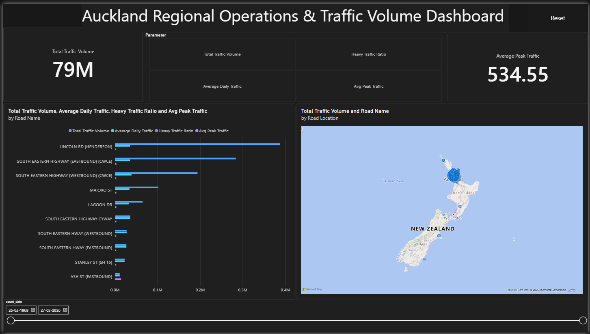

# 🚗 Auckland Regional Operations & Traffic Volume Dashboard

## 📌 Executive Summary
The **Auckland Regional Operations & Traffic Volume Dashboard** is an interactive, executive-grade Power BI analytics application built to help traffic engineers, urban planners, and regional council decision-makers monitor, analyze, and optimize traffic performance across the Auckland road network.

Featuring dynamic Field Parameter metric controls, interactive spatial mapping, custom DAX metrics, and a dark-mode UI, this dashboard converts millions of raw traffic observation records into clear, actionable transportation insights.

## 📸 Dashboard Screenshots

### 1. Default Overview View


### 2. Interactive Parameter Selection


---

## 🎯 Problem Statement & Challenges

Managing complex urban road networks requires instant access to corridor performance metrics, heavy vehicle distribution, and peak-hour traffic bottlenecks. However, regional transport authorities often encounter three major operational bottlenecks:

1. **Information Overload & Static Views:** Raw transport counts contain massive volumes of time-series observations mapped across thousands of geographic nodes. Traditional reporting tools force users to navigate through multiple static pages to evaluate different key performance indicators (KPIs).
2. **Lack of Integrated Geospatial Context:** Tabular and standard bar charts fail to communicate spatial relationships, making it difficult to visualize how traffic density correlates with specific geographical corridors across New Zealand's transport network.
3. **Complex Metric Comparison:** Comparing baseline volume (**Total Volume**) alongside rate indicators (**Heavy Traffic Ratio**) and capacity limits (**Peak Hour Traffic**) usually requires duplicate visuals that clutter executive reporting layouts.

---

This Power BI analytics solution addresses these challenges through an intuitive single-page executive view:

* **Dynamic Metric Switching (Field Parameters):** Enables users to toggle the primary analytical visualizations across four core operational metrics dynamically within a single visual container:
  * 📊 **Total Traffic Volume:** Net traffic volume across selected timeframes.
  * 🚘 **Average Daily Traffic (ADT):** Normalized daily traffic flow per corridor.
  * 🚛 **Heavy Traffic Ratio:** Proportional analysis of heavy vehicles impacting road wear and freight movement.
  * ⏱️ **Average Peak Traffic:** Hourly volume spikes during peak congestion windows.
* **Geospatial Intelligence:** Maps traffic density directly onto an interactive map using geographic coordinates, providing instant spatial awareness across Auckland's road locations.
* **Corridor Rank-Ordering:** Automatically ranks key arterial corridors (e.g., *Lincoln Road*, *South Eastern Highway*, *Dominion Road*) dynamically based on whichever metric parameter is active.
* **Streamlined User Experience:** Features custom report-page tooltips, date slider controls, single-select parameters, and a dedicated native **Reset All Slicers** button for effortless exploration.

---

## 🛠️ Data Architecture & Tech Stack

| Component | Technology | Role & Purpose |
| :--- | :--- | :--- |
| **Business Intelligence** | Power BI Desktop | Core visualization, UI architecture, and dashboard rendering |
| **Data Engine & DAX** | DAX Expressions | Dynamic parameter switching, ratio calculations, and custom measure logic |
| **Geospatial Mapping** | Bing Maps Integration | Spatial mapping of Auckland road nodes using spatial coordinates |
| **UI & UX Design** | Custom Dark Theme | High-contrast visual structure tailored for monitoring centers and executive presentations |

---

## 📐 Key DAX Measures & Parameters

### 1. Heavy Traffic Ratio Measure
Calculates the proportion of heavy vehicles (freight, trucks, buses) relative to overall traffic volume:
```dax
Heavy_Traffic_Ratio = 
DIVIDE(
    SUM('Average_Daily_Traffic_Counts'[pcheavy]),
    SUM('Average_Daily_Traffic_Counts'[Total Traffic Volume]),
    0
)
```

### 2. Average Daily Traffic (ADT) Measure
Calculates the average daily volume across the filtered context:
```dax
Average Daily Traffic = 
AVERAGE('Average_Daily_Traffic_Counts'[adt])
```

### 3. Dynamic Field Parameter Table
Drives the 4-tile UI slicer grid that dynamically updates the bar chart axes and visual legends:
```dax
Parameter = {
    ("Total Traffic Volume", NAMEOF('Average_Daily_Traffic_Counts'[Total Traffic Volume]), 0),
    ("Average Daily Traffic", NAMEOF('Average_Daily_Traffic_Counts'[Average Daily Traffic]), 1),
    ("Heavy Traffic Ratio", NAMEOF('Average_Daily_Traffic_Counts'[Heavy_Traffic_Ratio]), 2),
    ("Avg Peak Traffic", NAMEOF('Average_Daily_Traffic_Counts'[Avg_Peak_Traffic]), 3)
}
```

---

## 🔮 Future Enhancements
* **Machine Learning Forensics:** Incorporate predictive DAX forecasting to predict peak-hour traffic over 12-month horizons.
* **Real-time Incident Layering:** Integrate real-time weather and crash incident feeds to correlate volume spikes with road incidents.
* **Congestion Tier Segmentation:** Add dynamic categorization to flag corridors exceeding 85% capacity limits.

---

## 🚀 Getting Started & Setup

1. **Clone the Repository:**
   ```bash
   git clone https://github.com/Satnam-Singh-Analyst/auckland-traffic-dashboard.git
   ```
2. **Open in Power BI:** Open the `.pbix` file using **Power BI Desktop** (2024 version or later).
3. **Data Source Settings:** If prompted, re-point the dataset path to the included `Average_Daily_Traffic_Counts` source files.
4. **Interact:** Click any of the 4 metric parameter tiles in the top grid to slice the visuals dynamically, or use the **Reset** button in the upper right to restore default views.

## Author

* **Satnam Singh**
* Master of Arts (Economics) Candidate — Massey University
* **GitHub:** [@Satnam-Singh-Analyst](https://github.com/Satnam-Singh-Analyst)
* **LinkedIn:** [Satnam Singh](https://linkedin.com/in/satnam-singh-3b124a230)
